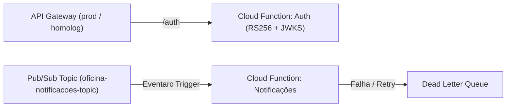

# Oficina Mecânica - Componentes Serverless

[](https://sonarcloud.io/summary/new_code?id=jcontiero_oficina-serverless)
[](https://sonarcloud.io/summary/new_code?id=jcontiero_oficina-serverless)
[](https://sonarcloud.io/summary/new_code?id=jcontiero_oficina-serverless)

## Propósito

Abriga as Cloud Functions de suporte (Autenticação de clientes por CPF com emissão de JWT RS256/JWKS e Notificações assíncronas via Eventarc/Pub/Sub) e a definição do **Google Cloud API Gateway** da Oficina Mecânica.

## Propriedade do State Terraform e Isolamento por Ambiente

- **Backend GCS:** `gs://pos-fiap-2026-tf-state`
- **Prefixo:** `env/shared/serverless`
- **Workspaces isolados por ambiente:**
  - `main` (GitHub Environment `production`, `environment = "prod"`): preserva os nomes canônicos em produção (`oficina-auth-function`, `oficina-notificacoes-function`, `oficina-notificacoes-topic`, `oficina-api-gateway`, `oficina-gateway`, bucket `pos-fiap-2026-functions-source` e segredo `database-url-prod`).
  - `homolog` (GitHub Environment `homolog`, `environment = "homolog"`): aplica sufixo `-homolog` em todos os recursos (`oficina-auth-function-homolog`, `oficina-notificacoes-function-homolog`, `oficina-notificacoes-topic-homolog`, `oficina-api-gateway-homolog`, `oficina-gateway-homolog`, bucket `pos-fiap-2026-functions-source-homolog`) e utiliza exclusivamente o segredo `database-url-homolog`.

## Tecnologias Utilizadas

- **Python 3.12** com **Functions Framework**
- **Terraform** (`>= 1.9.0`)
- **Google Cloud Functions v2** (Cloud Run)
- **Eventarc** & **Cloud Pub/Sub**
- **Google Cloud API Gateway**

## Passos para Execução, Testes e Deploy

### Testes Unitários e Cobertura Local (a partir da raiz)

```bash
pip install -e . pytest pytest-cov psycopg ruff
ruff check .
PYTHONPATH=src:src/notificacoes pytest tests/unit --cov=src --cov-report=term-missing --cov-fail-under=80
```

### Execução Local das Functions

```bash
functions-framework --target=auth_handler --port=8081
functions-framework --target=notificacoes_handler --signature-type=cloudevent --port=8082
```

### Planejamento e Deploy Terraform (a partir da pasta `terraform/`)

```bash
cd terraform
gcloud auth application-default login
terraform init
terraform workspace select homolog # ou main
terraform plan -var-file="environments/homolog.tfvars"
```

### Rollback

1. Reverter o Pull Request na branch correspondente (`homolog` ou `main`) para reimplantar a revisão anterior do pacote `.zip` e da configuração OpenAPI do API Gateway.
2. Em emergência operacional no Cloud Run/Functions v2, redirecionar o tráfego para a revisão anterior via `gcloud run services update-traffic`.

## Diagrama de Arquitetura



## Repositórios Relacionados

- [oficina-api](https://github.com/jcontiero/oficina-api) — OS Service e Orquestrador Saga
- [oficina-k8s-infra](https://github.com/jcontiero/oficina-k8s-infra) — GKE, VPC e Datadog Agent
- [oficina-database-infra](https://github.com/jcontiero/oficina-database-infra) — Cloud SQL e Secret Manager
